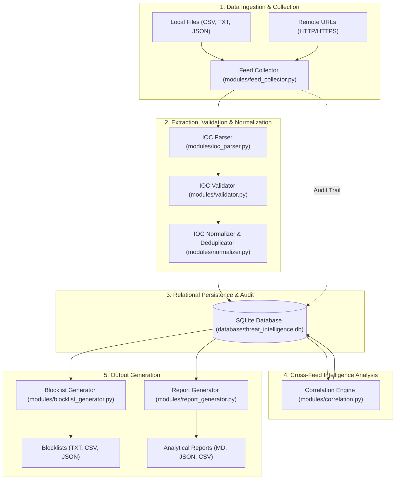
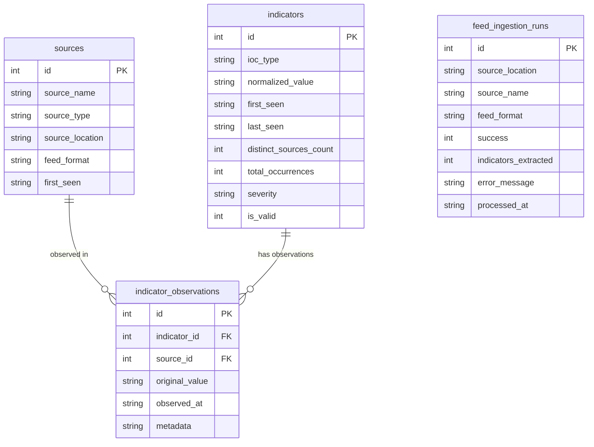

# System Architecture & Technical Specifications

**Project:** Threat Intelligence Aggregator (Non-AI)  
**Classification:** Defensive Cybersecurity / Blue Team Automation Toolkit  
**Author:** Blue Team Systems Architect & Senior Python Developer  
**Status:** Academic MVP Specification — Fully Implemented  

---

## 1. Executive Summary & Design Philosophy

The **Threat Intelligence Aggregator** is a deterministic, rule-based cybersecurity command-line tool built purely in Python 3. It serves SOC analysts, incident response teams, and security engineers by automating the ingestion, parsing, sanitization, correlation, and formatting of multi-source cyber threat intelligence (CTI).

### Core Principles
- **Strictly Non-AI:** All evaluation decisions are made using deterministic heuristics, mathematical graph/set correlation, cryptographic hashing, and formal RFC network syntax validation.
- **High Performance & Safety:** Standard Python libraries (`re`, `ipaddress`, `sqlite3`, `pathlib`, `hashlib`, `urllib.parse`) ensure low memory footprints, minimal attack surfaces, and rapid throughput without external cloud dependencies.
- **Defensive Blue Team Focus:** Segregates private/reserved internal addresses from externally routable threats, strips defanged characters safely, neutralizes CSV injection risks, enforces SSRF protections, and produces directly ingestible outputs for firewalls, DNS sinks, proxies, and SIEMs.

---

## 2. End-to-End Component Pipeline & Data Flow



### Detailed Pipeline Flow
1. **Feed Sources:** Threat intelligence is collected from local filesystem benchmarks (`CSV`, `TXT`, `JSON`) or remote threat feeds over `HTTP`/`HTTPS`.
2. **Feed Collector:** Enforces strict stream size boundaries, configurable network timeouts, proxy isolation, manual redirect evaluation, and pre-connection destination address validation.
3. **IOC Parser:** Extracts candidate indicators across 8 distinct categories using structure-aware column parsers and span-masking regex algorithms.
4. **Validator:** Evaluates syntax compliance with formal RFC specifications and cryptographic hash standards; classifies network address space without issuing external network queries.
5. **Normalizer:** Transforms valid indicators into canonical lowercase/standardized formats and collapses intra-batch duplicates while maintaining observation provenance.
6. **SQLite Database Manager:** Persists feeds, canonical indicators, observation provenance, and ingestion run audits using atomic ACID transactions and parameterized queries.
7. **Correlation Engine:** Evaluates multi-source corroboration, counts distinct reporting feeds, and updates deterministic severity ratings across the indicator repository.
8. **Downstream Generators:** Produces categorized perimeter blocklists (`TXT`, `CSV`, `JSON`) and comprehensive intelligence reports (`Markdown`, `JSON`, `CSV`).

---

## 3. Supported IOC Specifications & Validation Logic

The aggregator natively processes eight primary Indicator of Compromise (IOC) categories:

| IOC Type | Syntax & RFC Standard | Validation & Sanitization Logic | Blue Team Operational Considerations |
|:---|:---|:---|:---|
| **IPv4** | RFC 791 dotted decimal (`X.X.X.X`) | Validated via `ipaddress.IPv4Address`; rejects non-decimal octets and out-of-range values. | Flags RFC 1918 private (`10.0.0.0/8`, `172.16.0.0/12`, `192.168.0.0/16`), loopback (`127.0.0.0/8`), link-local (`169.254.0.0/16`), and multicast. |
| **IPv6** | RFC 4291 / RFC 5952 standard notation | Validated via `ipaddress.IPv6Address`; supports full and compressed `::` representations. | Flags loopback (`::1`), link-local (`fe80::/10`), documentation (`2001:db8::/32`), and unique local (`fc00::/7`). |
| **Domain** | RFC 1035 / RFC 1123 FQDN | Label length checks (1–63 chars, max 253 total); validates alphabetic TLD; rejects bare IP addresses and consecutive dots. | Strips trailing DNS root dots; performs safe IDNA/Punycode normalization (`xn--`). |
| **URL** | RFC 3986 URI specification | Strictly restricts schemes to `http` and `https`; validates netloc host and port syntax. | Strips defanging (`hxxp`, `[.]`); removes default ports (`:80`, `:443`); preserves queries and fragments. |
| **Email** | RFC 5322 addr-spec format | Verifies single `@` delimiter, valid local-part syntax, and valid domain hostname. | Preserves local-part case sensitivity (RFC 5321); lowercases domain portion. |
| **MD5** | 32-character hexadecimal | Regex validation: `^[a-fA-F0-9]{32}$`. | Converted to lowercase canonical form; fast lookup for legacy artifacts. |
| **SHA1** | 40-character hexadecimal | Regex validation: `^[a-fA-F0-9]{40}$`. | Converted to lowercase canonical form; forensic and digital signature auditing. |
| **SHA256** | 64-character hexadecimal | Regex validation: `^[a-fA-F0-9]{64}$`. | Converted to lowercase canonical form; primary modern cryptographic malware signature standard. |

---

## 4. Production Relational Database Schema (SQLite)

All database operations strictly enforce parameterized queries (`?`) to prevent SQL injection vulnerabilities. Foreign key constraints are enforced at connection initialization via `PRAGMA foreign_keys = ON;`, and high concurrency is enabled via `PRAGMA journal_mode = WAL;`.

### Relational Entity-Relationship Diagram



### Table Definitions & Column Specifications

#### 1. `sources`
Tracks distinct threat intelligence feeds (local files or remote URLs) ingested into the system.
- `id` (INTEGER PRIMARY KEY AUTOINCREMENT): Unique feed identifier.
- `source_name` (TEXT NOT NULL): Human-readable name or filename of the feed.
- `source_type` (TEXT NOT NULL): Feed transport type (`file` or `url`).
- `source_location` (TEXT NOT NULL): Absolute file path or remote URL string.
- `feed_format` (TEXT NOT NULL): Data serialization format (`csv`, `txt`, or `json`).
- `first_seen` (TEXT NOT NULL): ISO 8601 UTC timestamp of initial feed registration.
- **Constraints:** `UNIQUE(source_name, source_location)`

#### 2. `indicators`
Stores unique canonical Indicators of Compromise and their aggregated correlation metrics.
- `id` (INTEGER PRIMARY KEY AUTOINCREMENT): Unique indicator identifier.
- `ioc_type` (TEXT NOT NULL): IOC classification (`ipv4`, `ipv6`, `domain`, `url`, `email`, `md5`, `sha1`, `sha256`).
- `normalized_value` (TEXT NOT NULL): Canonical normalized indicator string.
- `first_seen` (TEXT NOT NULL): ISO 8601 UTC timestamp of earliest observation.
- `last_seen` (TEXT NOT NULL): ISO 8601 UTC timestamp of most recent observation.
- `distinct_sources_count` (INTEGER DEFAULT 1): Count of unique feeds reporting this indicator.
- `total_occurrences` (INTEGER DEFAULT 1): Cumulative observation count across all ingestions.
- `severity` (TEXT NOT NULL): Deterministic heuristic rating (`HIGH`, `MEDIUM`, `LOW`).
- `is_valid` (INTEGER DEFAULT 1): Structural validation flag (1 for valid, 0 for invalid).
- **Constraints:** `UNIQUE(ioc_type, normalized_value)`

#### 3. `indicator_observations`
Provides granular audit provenance linking canonical indicators to their reporting feeds.
- `id` (INTEGER PRIMARY KEY AUTOINCREMENT): Unique observation record identifier.
- `indicator_id` (INTEGER NOT NULL): Foreign key referencing `indicators(id)` ON DELETE CASCADE.
- `source_id` (INTEGER NOT NULL): Foreign key referencing `sources(id)` ON DELETE CASCADE.
- `original_value` (TEXT NOT NULL): Raw, unnormalized indicator string as extracted from source.
- `observed_at` (TEXT NOT NULL): ISO 8601 UTC timestamp of the observation.
- `metadata` (TEXT): JSON-serialized key-value dictionary of auxiliary feed attributes.
- **Constraints:** `UNIQUE(indicator_id, source_id, original_value, observed_at)`

#### 4. `feed_ingestion_runs`
Maintains an immutable historical audit log of feed collection and ingestion operations.
- `id` (INTEGER PRIMARY KEY AUTOINCREMENT): Unique run execution identifier.
- `source_location` (TEXT NOT NULL): Target file path or URL processed.
- `source_name` (TEXT NOT NULL): Identifier of the feed source.
- `feed_format` (TEXT): Detected format (`csv`, `txt`, `json`).
- `success` (INTEGER NOT NULL): Execution status flag (1 for success, 0 for failure).
- `indicators_extracted` (INTEGER DEFAULT 0): Total candidate indicators parsed from feed.
- `error_message` (TEXT): Detailed error description if execution failed.
- `processed_at` (TEXT NOT NULL): ISO 8601 UTC timestamp of run completion.

#### 5. Compatibility View: `feed_runs`
A permanent relational view defined as:
```sql
CREATE VIEW IF NOT EXISTS feed_runs AS SELECT * FROM feed_ingestion_runs;
```
Ensures backward compatibility with reporting and query interfaces across toolkit components.

### Database Indexes
- `idx_indicators_type_val` ON `indicators(ioc_type, normalized_value)`
- `idx_indicators_severity` ON `indicators(severity)`
- `idx_observations_indicator` ON `indicator_observations(indicator_id)`
- `idx_observations_source` ON `indicator_observations(source_id)`
- `idx_feed_runs_processed_at` ON `feed_ingestion_runs(processed_at)`

---

## 5. Cross-Feed Correlation & Deterministic Risk Scoring

The **Correlation Engine** (`modules/correlation.py`) evaluates multi-source corroboration across the indicator repository. Corroboration is measured strictly by counting distinct reporting sources:

$$\text{Distinct Sources Count} = |\{ \text{source\_id} \mid \text{observation} \in \text{indicator} \}|$$

Repeated occurrences of an indicator within the *same* feed (e.g., duplicate entries in a single firewall log) increment `total_occurrences` but **do not** inflate `distinct_sources_count`.

### Heuristic Risk Scoring Model

| Severity Tier | Distinct Reporting Sources | Blue Team Operational Interpretation |
|:---:|:---:|:---|
| **HIGH** | $\ge 5$ distinct feeds | Widespread consensus across multiple independent threat feeds. Direct candidate for automated perimeter enforcement (firewall drops, EDR blocklists). |
| **MEDIUM** | $2 \dots 4$ distinct feeds | Corroborated cross-feed indicator. Recommended for heightened monitoring, SIEM detection rules, and DNS sinkholing. |
| **LOW** | $1$ distinct feed | Single-source isolated sighting. Recommended for watchlist staging, retroactive log hunting, or threat research. |

> [!NOTE]
> **Heuristic Nature:** Severity scores are deterministic mathematical indicators of reporting density and multi-source consensus. They do not constitute absolute proof of malicious intent.

---

## 6. Dissemination & Output Artifacts

### 1. Blocklist Generator (`modules/blocklist_generator.py`)
Generates production-grade, categorized blocklists directly from correlated database indicators:
- **Formats:**
  - **Plain Text (`.txt`):** One canonical indicator per line; formatted for direct firewall consumption, DNS response policy zones (RPZ), and proxy rules.
  - **Tabular CSV (`.csv`):** Includes indicator value, IOC type, severity rating, distinct source counts, total sightings, first seen, and last seen timestamps.
  - **Structured JSON (`.json`):** Machine-readable export with comprehensive metadata, filter parameters, and full source provenance arrays.
- **Granular Controls:** Category filtering (`--type`), multi-category separate or unified exports (`--all`, `--combined`), severity filtering (`--severity`), minimum feed thresholds (`--min-sources`), noise filtering (`--exclude-low`), and cross-feed isolation (`--cross-feed-only`).

### 2. Report Generator (`modules/report_generator.py`)
Produces audit-grade threat intelligence and operational reports:
- **Formats:** GitHub-Flavored Markdown (`.md`), JSON (`.json`), and CSV (`.csv`).
- **Core Sections:** Executive Summary, Category Distribution, Severity Analysis & Scoring Model, Cross-Feed Correlation Details, Intelligence Source Metrics, Top Repeated Indicators, Data Quality & Integrity Audit, and Feed Ingestion Run Summary.

---

## 7. Security Controls, Hardening & Defensive Architecture

### 1. Server-Side Request Forgery (SSRF) Protection (`FeedCollector`)
Outbound network requests targeting remote threat feeds are safeguarded against intranet traversal and SSRF attacks:
- **Disabled Automatic Redirects:** `allow_redirects=False` is enforced on all outbound requests. All HTTP redirects (`301`, `302`, `303`, `307`, `308`) are intercepted and evaluated manually against a strict hop budget (maximum 5 redirects).
- **Pre-Connection Destination Validation:** Every URL host and redirect target is resolved and validated *before* establishing any socket connection. Outbound requests are aborted immediately if the destination resolves to a prohibited address.
- **Prohibited Address Categories:** Rejects `localhost`, loopback (`127.0.0.0/8`, `::1`), RFC 1918 private subnets (`10.0.0.0/8`, `172.16.0.0/12`, `192.168.0.0/16`), unique local IPv6 (`fc00::/7`, `fd00::/8`), link-local / cloud metadata (`169.254.0.0/16`, `fe80::/10`), multicast (`224.0.0.0/4`, `ff00::/8`), reserved (`240.0.0.0/4`), unspecified (`0.0.0.0`, `::`), and local domain suffixes (`.localhost`, `.local`, `.internal`).
- **IPv4-Mapped IPv6 Inspection:** Unpacks embedded IPv4 addresses in dual-stack mappings (e.g., `::ffff:127.0.0.1`, `::ffff:169.254.169.254`) and subjects them to full address boundary checks.
- **Multi-Answer DNS Inspection:** Inspects all IP addresses returned by `socket.getaddrinfo()`. If any resolved IP belongs to a prohibited category, the request is rejected immediately.
- **Proxy Environment Isolation:** Outbound HTTP requests explicitly pass `proxies={"http": None, "https": None}` to prevent local proxy environment variables (`HTTP_PROXY`, `HTTPS_PROXY`) from rerouting connections.

### 2. Documented DNS Rebinding TOCTOU Limitation
- **Pre-Validation Scope:** Hostnames are resolved and checked via `socket.getaddrinfo()` prior to requesting remote resources.
- **Inherent TOCTOU Limitation:** Standard Python HTTP clients (`requests` / `urllib3`) execute an independent internal DNS resolution during TCP socket establishment. If an adversary configures an authoritative nameserver returning a public IP during pre-validation and subsequently returns an internal/loopback IP with a 0-second TTL during connection, the underlying socket will connect to the altered IP.
- **Defensive Boundary:** Full prevention of DNS rebinding requires low-level socket IP pinning or custom transport adapters, which exceeds the scope of this non-AI standard library MVP.

### 3. CSV Formula Injection Neutralization
- Exported CSV blocklists and analytical reports sanitize all cells beginning with formula trigger characters (`=`, `+`, `-`, `@`, `\t`, `\r`) by prepending a single quote (`'`).
- Prevents Dynamic Data Exchange (DDE) and arbitrary command execution when CSV files are opened in spreadsheet applications (Microsoft Excel, LibreOffice Calc).

### 4. Academic MVP Scope Disclaimer
This software is an **academic minimum viable product (MVP)** intended for controlled laboratory testing, educational demonstration, and local Blue Team research. It is not an enterprise-hardened network proxy or perimeter security gateway.
