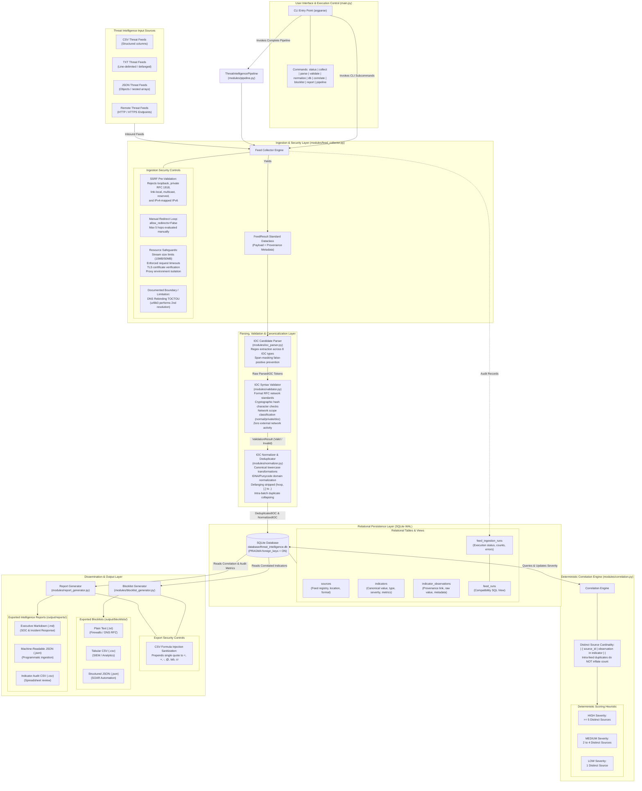

# Threat Intelligence Aggregator — Architecture Diagram & System Model

**Classification:** Defensive Cybersecurity / Blue Team Automation Toolkit  
**Academic Specification:** Deterministic, Non-AI Threat Intelligence Lifecycle  
**Repository Root:** `Threat-Intelligence-Aggregator/`  

---

## 1. System Architecture Diagram

The diagram below visualizes the deterministic, multi-stage architecture of the Threat Intelligence Aggregator toolkit. It illustrates the progression of intelligence from diverse feed sources through collection, parsing, RFC validation, canonicalization, relational storage, heuristic correlation, and multi-format dissemination, alongside active security controls and architectural limitations.



---

## 2. Component Descriptions & Technical Specifications

### 2.1 Interface & Pipeline Orchestration
- **`main.py`:** The primary CLI interface implemented with Python standard library `argparse`. Exposes granular commands (`status`, `collect`, `parse`, `validate`, `normalize`, `db`, `correlate`, `blocklist`, `report`) and a unified end-to-end orchestration command (`pipeline`).
- **`modules/pipeline.py` (`ThreatIntelligencePipeline`):** Chained orchestration engine that executes collection, parsing, validation, canonicalization, deduplication, relational persistence, and correlation analysis in a single transactional run, with optional downstream generation of blocklists and analytical reports.

### 2.2 Ingestion & Feed Collection Layer
- **`modules/feed_collector.py` (`FeedCollector`):** Ingests local files (`CSV`, `TXT`, `JSON`) and remote network endpoints (`HTTP`/`HTTPS`).
- **Standardized Representation (`FeedResult`):** Captures payload, source location, feed format, fetch timestamp (ISO 8601 UTC), execution status, and error details.

### 2.3 Extraction, Validation & Normalization Layer
- **`modules/ioc_parser.py` (`IOCParser`):** Employs header-aware table parsing and span-masking regular expressions to extract candidate tokens across eight supported categories (`ipv4`, `ipv6`, `domain`, `url`, `email`, `md5`, `sha1`, `sha256`). Span-masking ensures that composite indicators (such as URLs or Emails) do not generate spurious duplicate entries for embedded hostnames or domains.
- **`modules/validator.py` (`IOCValidator`):** Evaluates candidate strings against formal RFC specifications (`RFC 791`, `RFC 4291`, `RFC 1035`, `RFC 3986`, `RFC 5322`) and cryptographic hexadecimal formats without performing external network queries. Classifies address space into `normal`, `private`, `loopback`, `link-local`, `multicast`, or `documentation`.
- **`modules/normalizer.py` (`IOCNormalizer`):** Standardizes indicators into canonical formats (lowercase schemes, hosts, hashes, and email domains; compressed IPv6; IDNA/Punycode encoding; trailing dot removal) and performs intra-batch deduplication based on `(ioc_type, normalized_value)`.

### 2.4 Persistent Relational Storage Layer
- **`modules/database_manager.py` (`DatabaseManager`):** ACID-compliant SQLite storage engine operating at `database/threat_intelligence.db`.
- **Relational Tables:**
  - **`sources`:** Registry of unique threat feed sources (`UNIQUE(source_name, source_location)`).
  - **`indicators`:** Canonical threat indicators with first/last seen timestamps, distinct source counts, total sightings, and severity ratings (`UNIQUE(ioc_type, normalized_value)`).
  - **`indicator_observations`:** Granular provenance audit linking each observation to its reporting feed source and raw value (`UNIQUE(indicator_id, source_id, original_value, observed_at)`).
  - **`feed_ingestion_runs`:** Historical execution audit tracking processed feeds, extracted indicator counts, error messages, and run timestamps.
  - **`feed_runs`:** Compatibility database view mirroring `feed_ingestion_runs`.

### 2.5 Deterministic Correlation & Risk Scoring Layer
- **`modules/correlation.py` (`CorrelationEngine`):** Measures multi-source corroboration strictly across distinct feed sources:
  $$\text{Distinct Sources Count} = |\{ \text{source\_id} \mid \text{observation} \in \text{indicator} \}|$$
- **Scoring Heuristics:**
  - **HIGH ($\ge 5$ distinct sources):** Consensus across 5 or more independent threat feeds; candidate for automated perimeter blocking.
  - **MEDIUM ($2 \dots 4$ distinct sources):** Corroborated cross-feed intelligence; recommended for SIEM rules and DNS sinkholing.
  - **LOW ($1$ distinct source):** Single-source sighting; candidate for watchlist tracking and retrospective log searches.

### 2.6 Dissemination & Export Layer
- **`modules/blocklist_generator.py` (`BlocklistGenerator`):** Exports filtered blocklists in line-delimited plain text (`.txt`), tabular comma-separated values (`.csv`), or structured `JSON`. Supports category filtering, multi-category separation or unification, severity thresholding, and noise exclusion.
- **`modules/report_generator.py` (`ReportGenerator`):** Synthesizes comprehensive threat intelligence and operational reports in GitHub Flavored Markdown (`.md`), structured `JSON`, and tabular `CSV`.

---

## 3. Security Boundaries & Defensive Controls

```text
+---------------------------------------------------------------------------------------------------+
|                                 DEFENSIVE SECURITY MATRIX                                         |
+------------------------------------+--------------------------------------------------------------+
| Security Dimension                 | Implementation Mechanism                                     |
+------------------------------------+--------------------------------------------------------------+
| Server-Side Request Forgery (SSRF) | Pre-connection DNS check against prohibited IP subnets;       |
|                                    | rejects loopback, RFC 1918, link-local, multicast, reserved; |
|                                    | inspects IPv4-mapped IPv6 (::ffff:127.0.0.1);                |
|                                    | manual redirect evaluation (allow_redirects=False, <= 5 hops)|
+------------------------------------+--------------------------------------------------------------+
| Environment Proxy Hijacking        | Outbound requests pass proxies={"http": None, "https": None} |
+------------------------------------+--------------------------------------------------------------+
| Resource Exhaustion                | Enforces download stream size boundaries (10MB default) and  |
|                                    | strict network timeouts (15.0s default)                      |
+------------------------------------+--------------------------------------------------------------+
| Transport Security                 | TLS certificate verification enabled by default              |
+------------------------------------+--------------------------------------------------------------+
| SQL Injection (SQLi)               | 100% parameterized queries (?) across all database operations|
+------------------------------------+--------------------------------------------------------------+
| CSV Formula Injection              | Prepends single quote (') to cells starting with =, +, -, @, |
|                                    | tab, or carriage return                                      |
+------------------------------------+--------------------------------------------------------------+
| Untrusted Indicator Execution      | Indicators treated strictly as inert data strings;           |
|                                    | zero shell execution or system reconfiguration               |
+------------------------------------+--------------------------------------------------------------+
| DNS Rebinding (Documented Limit)   | Pre-validation checks host via getaddrinfo(); however,       |
|                                    | requests/urllib3 performs a second DNS resolution during TCP |
|                                    | connect, leaving an acknowledged TOCTOU window for 0-TTL IPs |
+------------------------------------+--------------------------------------------------------------+
```

---

## 4. Academic Submission Verification

- **Pure Non-AI Implementation:** Zero neural networks, cloud LLM APIs, machine learning heuristics, or stochastic evaluators.
- **Standards Compliance:** Full adherence to RFC 791, RFC 4291, RFC 1035, RFC 3986, RFC 5322, and standard cryptographic hashing specifications.
- **Test Coverage:** Verified by an automated test suite comprising 154 unit and integration tests across 11 test modules.

